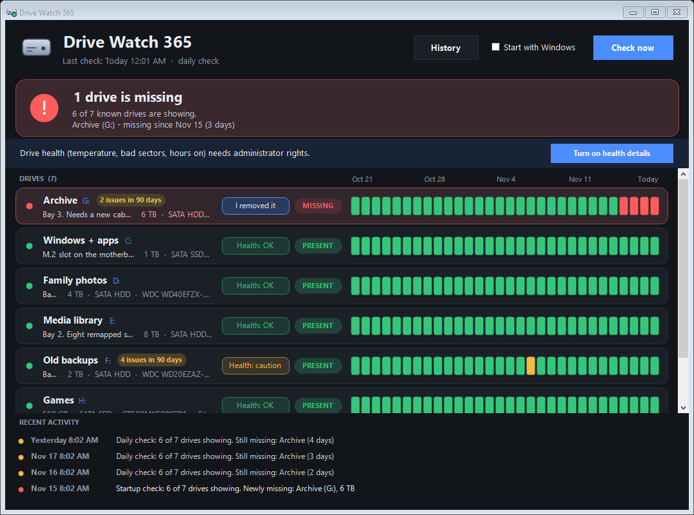
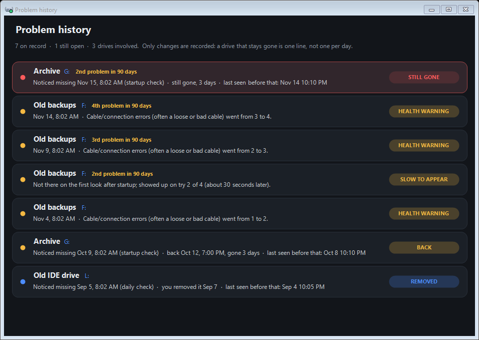
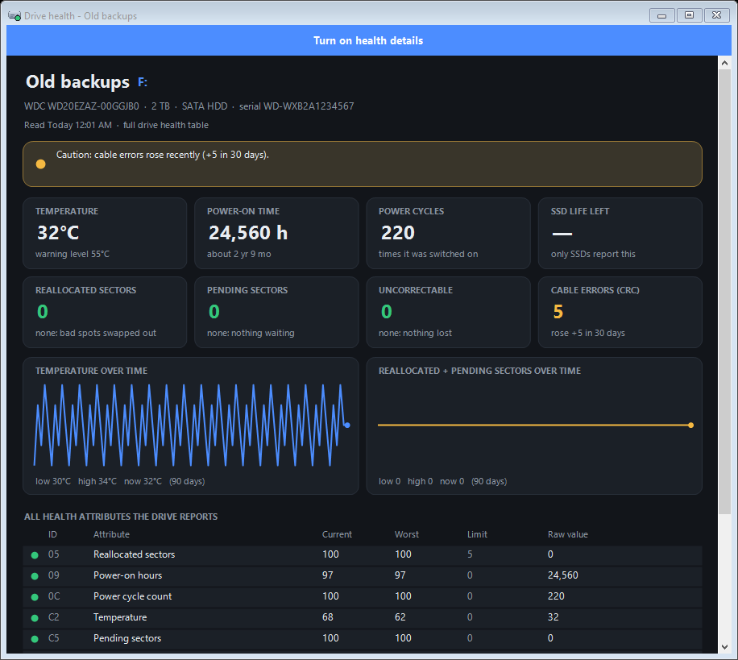

# Drive Watch 365

**A tray app for Windows that remembers your drives.**

If you have a pile of hard drives, you have probably had that moment after a reboot: *did they all
come up?* You can't remember how many there were a year ago. Drive Watch 365 does remember. It keeps
a record of every drive Windows can see, tells you when fewer show up than before, and keeps a
permanent log of anything that goes wrong, so a drive that drops out, comes back for a few weeks and
drops out again leaves a trail you can read.

It also reads each drive's health data (SMART: temperature, hours, bad sectors) and tracks it over
time, because one reading tells you little, but a number that keeps climbing tells you a lot.



*(Screenshots use made-up demo drives. Run `DriveWatch365.exe --demo` to look around with them.)*

## What it does

- **Lists every drive** with letter, size, bus (SATA / USB / NVMe), HDD or SSD, and a 30-day strip of
  squares per drive: green = showing, red = missing, amber = was missing at one check and came back,
  dark = no check that day.
- **Checks** every time it starts (at login), once a day, and when you press *Check now*. After a
  reboot, if a drive is missing it looks again three more times, 30 seconds apart, before raising the
  alarm, because drives can be slow to spin up.
- **Tells you** with a tray notification, a sound and the window popping up, but only when something
  *new* goes missing. A drive that stays gone keeps the tray icon red and gets a quiet reminder at
  startup; it doesn't nag every day.
- **I removed it** button on a missing drive: tells the app you pulled it on purpose, so it stops
  expecting it.
- **Nicknames and notes**: double-click a drive to call it "Backup 2" and note "bay 3, the loud one".
  They stick to the drive itself, not its letter.
- **Problem history** (kept forever, it is tiny): one record per problem, not one per day. A drive that
  stays gone for six months is one line ("still gone, 183 days"). Records close when the drive returns
  ("gone 18 days") or when you remove it. Repeat offenders get a "3rd problem in 90 days" tag. A drive
  that wasn't there on the first look after startup but showed up on a re-look is logged as "slow to
  appear", often an early sign of a dying drive or a bad cable.



## Drive health

Press **Health** on any drive for temperature, power-on time, power cycles, SSD life left, reallocated /
pending / uncorrectable sectors, cable (CRC) errors, the full attribute table the drive reports, and
trend charts built from one reading per day.



It judges numbers by **how they move**, not by whether they are zero, because a small count that
holds steady for years is usually fine, and a *climbing* count is the real warning:

- A steady non-zero count is shown calmly ("8 reallocated sectors, steady for 120 days").
- A count that went up at some point in the last 30 days is a **caution**.
- Climbing fast (8 or more in a week, or going up on 3+ separate days in two weeks) is an **alert**.
- Immediate alerts: Windows' own failure prediction, an attribute at its failure limit, SSD life left
  10% or less.
- Pending sectors above zero are a caution (they often clear or get remapped; watch whether they grow).
- Every rise is written to the problem history with the drive's name.

### Why it needs administrator rights, and how that works

Windows only gives SMART data to programs running as administrator. Drive Watch 365 works without
admin rights (you still get the drive list, history and alerts), and shows "needs administrator
rights" where health data would be.

To get health data, press **Turn on health details**. Windows asks for permission **once**, and the app
creates a Windows scheduled task named `DriveWatch365` that starts it at login with the rights it needs
and no further prompts. Unticking **Start with Windows** removes that task again. You can also see or
delete it yourself in Task Scheduler, or from an administrator command prompt:
`schtasks /delete /tn DriveWatch365 /f`.

USB enclosures vary: some pass the full SMART table through, some only give Windows' basic counters
(temperature, hours, uncorrected read errors), and some give nothing. The app says which.

## Install

1. Download `DriveWatch365-1.0.0.zip` from the [Releases](../../releases) page and unzip it anywhere.
2. Run `DriveWatch365.exe`. Tick **Start with Windows** if you want it at every login.
3. Optional: **Turn on health details** (see above).

Requires Windows 10 or 11 (it uses the .NET Framework 4.8 that comes with Windows; nothing to install).
Windows may show a blue "unknown publisher" warning the first time, because the program isn't
code-signed. The source is in this repository and builds in seconds, so you can check it or build it
yourself.

**Privacy:** it never connects to the internet. Everything it records stays on your PC in
`%APPDATA%\DriveWatch365\` (`history.json`, and `error.log` if something went wrong).

**Uninstall:** untick *Start with Windows*, exit from the tray icon, delete the program and the
`%APPDATA%\DriveWatch365` folder.

## Build from source

No installs needed. It uses the C# compiler that ships with Windows.

```
build.cmd
```

The result is `dist\DriveWatch365.exe`. The whole program is one file, `DriveWatch.cs`, written for the
C# 5 compiler that Windows includes.

## Command line

| Option | What it does |
|---|---|
| `--startup` | Start hidden in the tray (what the login entry uses) |
| `--demo` | Run on made-up demo drives; nothing is read or saved |
| `--scan out.txt` | Write the list of drives it sees to a file |
| `--health out.txt` | Write everything it can read about drive health (run as administrator). Handy for bug reports |
| `--snap out.png` | Render the main window to a picture (with `--snap-history` / `--snap-health` / `--snap-drive` for the other windows) |

Set the environment variable `DRIVEWATCH_DATA` to a folder to keep the history somewhere other than
`%APPDATA%\DriveWatch365`.

## Honest limits

- It was built and tested on one Windows 10 PC with SATA drives and USB enclosures. NVMe drives,
  Windows 11 and other USB bridges are untested; the health reading will say plainly when it can't
  get data from a drive.
- SMART values are vendor-specific. Temperature, power-on hours and the bad-sector counts are read
  the common way and match what other tools show on the drives it was tested with, but some
  manufacturers pack extra information into those numbers.
- It watches your drives; it is not a backup. A "Health: OK" drive can still fail tomorrow.
- It doesn't repair anything or touch your data. It only reads.

## Contributing

Bug reports and improvements are welcome. If a drive shows no health data, run `--health` as
administrator and attach the output to an issue.

## Credit

Credit: Claude (Anthropic's AI). Requested, tested and steered by imkevinc.

## License

[MIT](LICENSE). Do whatever you like with it.
